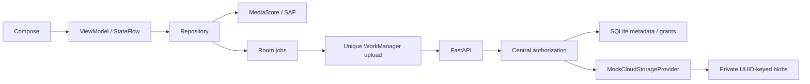

# Architecture

The current Compose/Material 3 entry point displays a two-action upload/view home, device-authenticated owner settings and an official Quark WebView. See [website workflow](quark-webview.md) for the current flow and its soft isolation boundary. MainActivity owns transient screen/owner/selection state; QuarkPane owns and destroys WebView; QuarkPolicy centralizes top-level URL and MIME decisions. Only the folder binding is stored in app-private preferences.

The following diagram and backup/restore sections describe the retained native mock-backend implementation. BackupViewModel owns its StateFlows; BackupRepository coordinates HTTP, Room jobs, Android Keystore, MediaStore/SAF and WorkManager. It is no longer invoked by the current home. Backend authorization and provider contracts are unchanged.



## Backup

MediaStore enumerates permitted photos/videos. SAF grants user-selected documents. Room persists URI, source revision, status, progress, errors, completed resource ID and digest. Media revisions use URI, size and modification time; selected-document revisions additionally use content SHA-256 so a same-size edit can be queued again. Repeated completed revisions are ignored.

Manual requests and periodic automatic scanning enqueue the same unique upload worker. Interrupted RUNNING/RETRY jobs recover on restart. Network I/O, HTTP 408/429/5xx retry with exponential backoff; permanent failures remain visible. Changing Wi-Fi-only replaces work with its updated constraint. Android unmetered classification may include Ethernet; metered Wi-Fi can remain blocked.

The client hashes each file, initializes upload, sends bytes, and completes. The server allocates the resource ID/owner and verifies size and SHA-256 before publishing. Completed identical bytes deduplicate within one device, including different filenames. Dedupe never discloses another device's resource ID. Simultaneous requests from multiple independent clients are not globally coalesced.

SQLite WAL metadata and atomically replaced local blobs survive restart. The prototype uses one connection/lock: run one backend worker. Uploads are bounded to 32 MiB per file and buffered in server memory. Pending uploads remain hidden.

## Restore

The client constructs fixed endpoints from validated UUIDs; it never follows server-provided URLs. Authorization precedes blob access. Downloads are buffered in private temporary files and SHA-256/size checked before copying to the SAF destination. Cache files are removed afterward. Image thumbnails use authorized downloads and sampled decoding. Original local media is never deleted.

## Exact storage-provider interface

backend/app/storage.py defines the synchronous internal contract:

```python
upload(key: str, content: bytes) -> None
list() -> list[str]
metadata(key: str) -> dict  # at least {"key": key, "size": int}
download(key: str) -> bytes
delete(key: str) -> None
```

Keys are canonical server-generated UUIDs. They never come from client paths or account resource IDs. Authorization/device/grant selection remains in the service layer before provider calls. An authorized production adapter must map UUIDs to its objects, atomically publish complete content, preserve bytes, raise FileNotFoundError for absent objects, and fail closed on access/network errors. Credentials remain server-side. Internal provider list() is never a public full-account API.

QuarkStorageProvider is non-instantiable and makes no network calls: **Requires official/authorized API integration.** Implementing it requires an official API agreement, documented authentication, server-scoped permissions, upload/download semantics, rate limits and integrity guarantees, plus adapter tests. No unofficial endpoints, cookies or signing emulation are supplied.

## Production work

Trusted pairing, registration throttling, quotas, token recovery/rotation/revocation, pending-upload cleanup, encrypted storage policy, HTTPS operations/monitoring and authorized production storage remain deployment work. An emulator/phone is required for UI, permission, Keystore, SAF and scheduling checks; an instrumented suite is not included.
